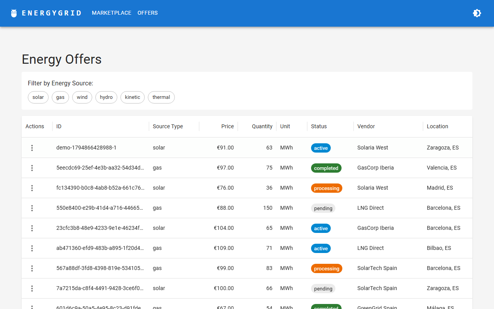
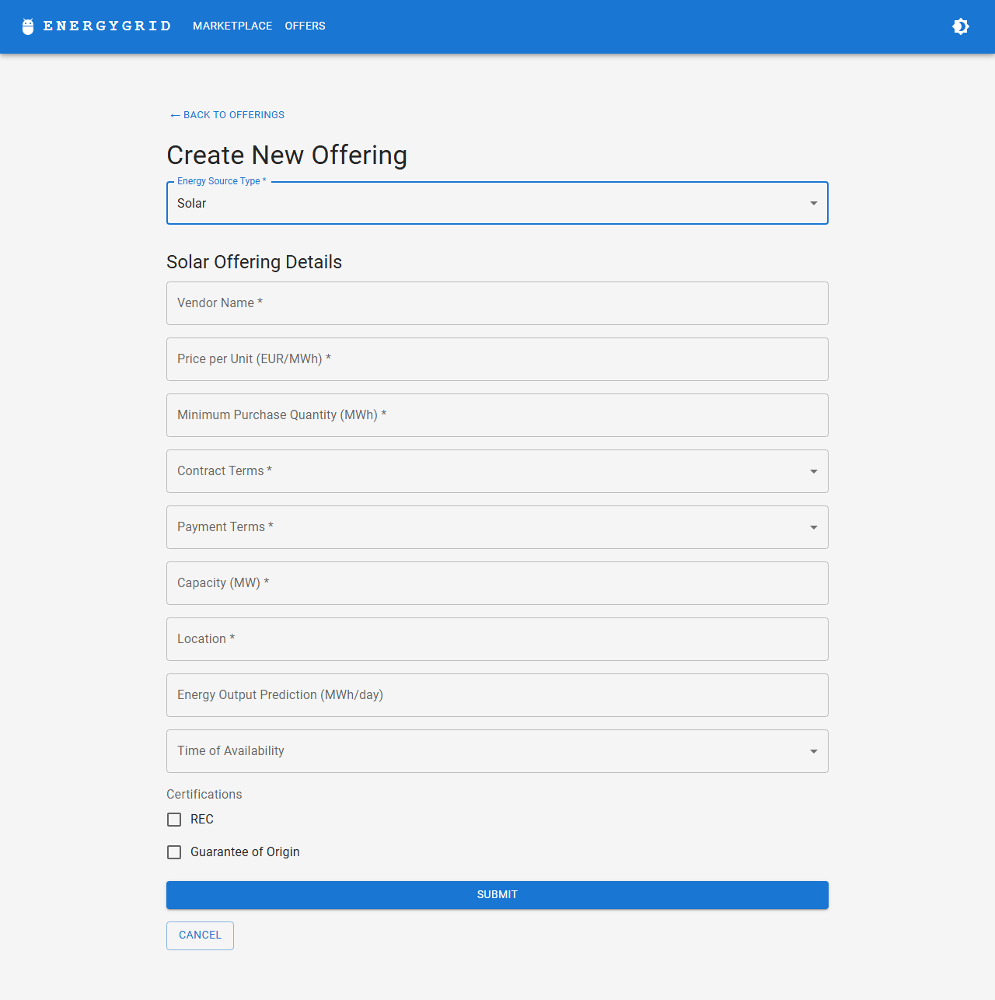

# Energy Trading Grid

[](https://github.com/Knightly95/energy-trading-grid/actions/workflows/deploy.yml)
[](#testing)

**[▶ Live demo](https://knightly95.github.io/energy-trading-grid/)**: runs entirely in your browser, with a simulated live data feed. No sign-up or backend is needed.

> **Background:** I built this project as a take-home for a frontend technical assessment in a hiring process, then moved it to my personal account and added an in-browser backend so anyone can try it. The commit history is the original one. The small Node.js servers in [`api/`](api) came with the assessment's starter template.

A real-time marketplace for energy offers, built with React and TypeScript. Offers for solar and gas energy arrive over a WebSocket and the grid updates as they are created, changed and removed.

## Screenshots

| Live offers grid | Form generated from JSON |
| --- | --- |
| [](docs/screenshots/offers-grid.png) | [](docs/screenshots/offering-form.png) |
| Offers arrive over a WebSocket; rows are added, updated and removed as they change. | Choosing an energy source builds the form for it from the JSON configuration. |

## Features

- **Live offers grid:** rows are added, updated and removed in real time. Changed rows and cells flash so the eye can follow the feed, and only the components affected by an update re-render.
- **Filtering and details:** filter offers by status and open any offer in a detail view to move it through its lifecycle (pending → processing → active → completed).
- **Marketplace of offerings:** create and edit energy offerings through a form that is generated from a JSON configuration, so each energy source type gets its own fields and validation.
- **Connection status and metrics:** the UI shows the state of the socket connection and the latest market metrics.
- **Light and dark themes.**

## Tech stack

React 19 · TypeScript · Vite · Zustand · TanStack Query · Material UI with MUI X Data Grid · React Hook Form · Socket.io · Vitest + React Testing Library · Playwright

## Getting started

Prerequisite: Node.js 22 or newer.

```bash
npm install
npm run dev        # http://localhost:5173, with the in-browser backend
```

To run against the real Node.js servers in `api/` instead:

```bash
npm run install:all
npm run dev:all    # frontend + REST API (port 3000) + WebSocket server (port 4001)
```

| Script                  | What it does                                              |
| ----------------------- | --------------------------------------------------------- |
| `npm run dev`           | Start the frontend with the in-browser backend            |
| `npm run dev:all`       | Start the frontend and both local servers                 |
| `npm run build`         | Type-check and build for production                       |
| `npm run lint`          | Run ESLint                                                |
| `npm test`              | Run unit and integration tests (Vitest)                   |
| `npm run test:coverage` | Run the tests with a coverage report                      |
| `npm run test:e2e`      | Run the end-to-end tests (Playwright) against the servers |

## Backends

The app talks to two services:

- a **WebSocket server** (Socket.io) that streams offers: `offers:init`, `offers:created`, `offers:updated`, `offers:removed` and `ops:metric`, and accepts `offers:pending`, `offers:processing` and `offers:completed`;
- a **REST endpoint**, `GET /api/energy-offerings`, that returns the form configuration.

### In-browser backend (default)

[`src/mocks/mockSocket.ts`](src/mocks/mockSocket.ts) implements the part of the Socket.io client API the app uses and emits the same events as the real server on a random schedule. The form configuration is served from a local JSON file. Nothing outside the socket and REST service modules knows the difference.

### Live servers

`VITE_BACKEND=live` switches to the real servers. `npm run dev:all` sets this for you through [`.env.live`](.env.live). To point at servers elsewhere, set `VITE_API_URL` and `VITE_SOCKET_URL`.

## Testing

- **Unit and integration** (Vitest, React Testing Library): stores, services, form conversion, pages, shared components, and the in-browser socket server.
- **End-to-end** (Playwright): the offers list and the offering add, edit and list flows, written with page objects and run against the real local servers.

CI measures line coverage of the unit and integration tests on every push to `main` and publishes the number shown in the badge above.

### Quality checks

A second CI job builds the app and checks what visitors get:

- **Lighthouse** (mobile settings): the build fails if accessibility drops below 95 or best practices below 90; performance and SEO are reported. Last run: performance 99, accessibility 100, best practices 100, SEO 100.
- **Bundle budget:** the JavaScript sent to the browser must stay under 365 kB gzip (today: 346.5 kB). To check locally: `npm run build && node scripts/bundle-budget.mjs dist 365`.

The Lighthouse report is attached to each CI run.

## Deployment

Every push to `main` is linted, tested (unit and end-to-end), built and deployed to GitHub Pages by [`.github/workflows/deploy.yml`](.github/workflows/deploy.yml).

## Documentation

- [`CONTRIBUTING.md`](CONTRIBUTING.md): setup, checks, conventions and how to propose a change.
- [`AGENTS.md`](AGENTS.md): commands, rules and guardrails for AI coding agents.
- [`architecture-decision-record.md`](architecture-decision-record.md): the reasoning behind Zustand, Socket.io, Material UI, the JSON-driven forms and the testing setup, with the trade-offs considered.
- [`api/README.md`](api/README.md): the REST and WebSocket servers.
